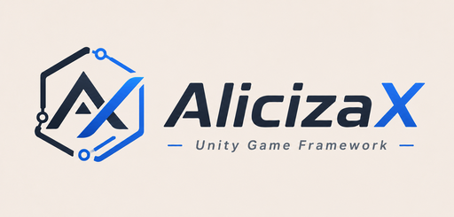

---
hide:
  - navigation
  - toc
---

  
  

# 面向商业化项目的 Unity 游戏框架

服务容器、资源管线、UI 管理、事件与计时、对象池、热更——收敛成一套装好即用的骨架。

[快速开始](quickstart.md){ .md-button .md-button--primary }
[框架仓库](https://github.com/AlicizaX/AlicizaXTemplate){ .md-button }

  <b>11</b> 个模块
  <b>145</b> 段示例代码
  <b>0 GC</b> 高频事件

## 快速入口

-   :material-rocket-launch-outline:{ .lg .middle } **快速入门**

    ---

    从 RootModule 启动到打开第一个 UI，跑通最小链路。

    [:octicons-arrow-right-24: QuickStart](quickstart.md)

-   :material-cog-outline:{ .lg .middle } **核心服务**

    ---

    服务容器、四级时间轮、零 GC 事件总线、流程调度。

    [:octicons-arrow-right-24: Service](modules/service/index.md)

-   :material-cube-outline:{ .lg .middle } **资源与对象**

    ---

    基于 YooAsset 的资源租约、场景加载、实例池与内存池。

    [:octicons-arrow-right-24: Resources](modules/resource/index.md)

-   :material-window-restore:{ .lg .middle } **UI 界面**

    ---

    窗口栈与层级、缓存与转场、Widget / Tab、页面导航。

    [:octicons-arrow-right-24: UI](modules/ui/index.md)

