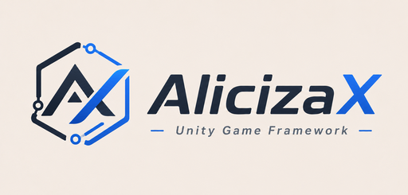

---
hide:
  - navigation
  - toc
---

  
  

# 面向商业化项目的 Unity 游戏框架

服务容器、资源管线、UI 管理、事件与计时、对象池、配置生成、热更——收敛成一套装好即用的骨架。

[快速开始](quickstart.md){ .md-button .md-button--primary }
[框架仓库](https://github.com/AlicizaX/AlicizaXTemplate){ .md-button }

  <b>17</b> 个模块
  <b>7</b> 个 UPM 包
  <b>1</b> 条 Luban 配置管线

## 快速入口

-   :material-rocket-launch-outline:{ .lg .middle } **快速入门**

    ---

    安装器铺项目 → Entry.prefab 启动 → 第一个窗口亮起来。

    [:octicons-arrow-right-24: QuickStart](quickstart.md)

-   :material-cog-outline:{ .lg .middle } **核心服务**

    ---

    服务容器与 Tick 生命周期、计时器、事件总线、流程调度。

    [:octicons-arrow-right-24: Service](modules/service/index.md)

-   :material-cube-outline:{ .lg .middle } **资源与对象**

    ---

    基于 YooAsset 的资源租赁、场景、实例池与内存池。

    [:octicons-arrow-right-24: Resources](modules/resource/index.md)

-   :material-window-restore:{ .lg .middle } **UI 界面**

    ---

    窗口声明与生命周期、路由转场、Widget / Tab、缓存策略。

    [:octicons-arrow-right-24: UI](modules/ui/index.md)

-   :material-gamepad-variant-outline:{ .lg .middle } **输入**

    ---

    设备读取、重绑定、快捷键、UI 导航、输入图标与反馈。

    [:octicons-arrow-right-24: Input](modules/input/index.md)

-   :material-view-grid-outline:{ .lg .middle } **UI 扩展与列表**

    ---

    UX 控件封装，以及 RecyclerView 虚拟列表的多模板、分组、循环与导航。

    [:octicons-arrow-right-24: UI Extension](modules/ui-extension/index.md)

-   :material-table-large:{ .lg .middle } **配置与本地化**

    ---

    Luban 配置管线生成代码与数据，Localization 负责运行时词库与 TMP 绑定。

    [:octicons-arrow-right-24: Config](modules/config/index.md)
    · [Localization](modules/localization/index.md)

-   :material-tools:{ .lg .middle } **工具链**

    ---

    运行时调试器、编辑器扩展、项目安装器。

    [:octicons-arrow-right-24: Debugger](modules/debugger/index.md)
    · [Editor Extension](modules/editor-extension/index.md)
    · [Installer](modules/installer/index.md)

