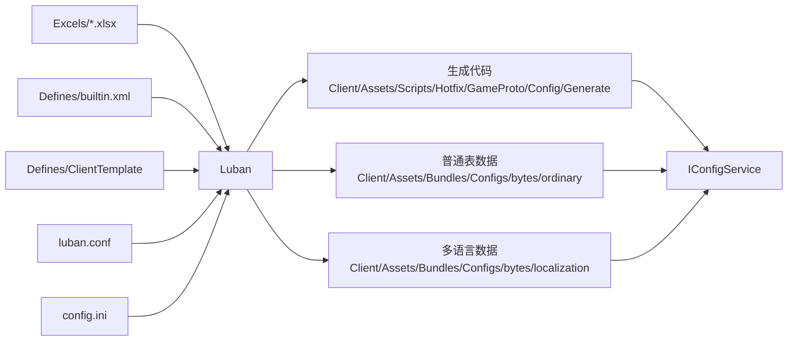

# Config 配置管线

Config 是仓库根目录下的**离线配置管线**：策划在 Excel 里维护表，Luban 把表编译成 C# 代码和二进制数据，Unity 运行时通过生成的 `IConfigService` 读取。它不参与运行时加载，也不是手写代码目录。



## 适用场景

- 新增/修改数值表、道具表、商店表等结构化配置。
- 给配置表增加多语言文案列，并跟随运行时语言切换。
- 升级 Luban 工具链，或排查“表改了但游戏里没变”的问题。

不适用：UI 文案词库属于 [Localization 本地化](../localization/index.md)；资源加载与包体属于 [Resources 资源](../resource/index.md)。

## 目录结构

`Config/` 只有四类内容，改动前先分清“源码”和“产物”：

| 路径 | 角色 | 是否手写 | 说明 |
| :--- | :--- | :--- | :--- |
| `Defines/builtin.xml` | 源码 | 是 | 内置类型定义：`vec2/vec3/vec4/color`、`AudioType`，以及映射到 `UnityEngine` 类型的 mapper |
| `Defines/ClientTemplate/cs-bin/*.sbn` | 源码 | 是 | 覆盖 Luban 默认 C# 模板：`bean.sbn`、`table.sbn`、`tables.sbn` |
| `Excels/__tables__.xlsx` | 源码 | 是 | 表清单：表名、记录类型、输入文件、索引、分组 |
| `Excels/__beans__.xlsx` | 源码 | 是 | bean 定义（字段组合成结构体） |
| `Excels/__enums__.xlsx` | 源码 | 是 | 枚举定义 |
| `Excels/Tables/*.xlsx` | 源码 | 是 | 普通表数据，文件名形如 `<Module>_<name>.xlsx` |
| `Excels/Localization/*.xlsx` | 源码 | 是 | 配置表多语言文案，`Texts` 工作表 |
| `Extensions/Luban.AlicizaX.Localization/` | 源码 | 是 | Luban 插件：INI 读取、多语言工作簿解析、暂存输出、校验 |
| `Tools/` | **产物** | 否 | 预构建的 Luban 运行时和模板，已提交到仓库，可用 `build.bat` 重建 |
| `Luban/` | 临时 | 否 | `build.bat` 克隆的 Luban 源码，构建结束后删除，已被 `.gitignore` 忽略 |
| `Tools.build/`、`Tools.backup/` | 临时 | 否 | 构建暂存与回滚目录，正常结束时清空 |
| `luban.conf` | 源码 | 是 | Luban 工程配置：schema、数据目录、目标 |
| `config.ini` | 源码 | 是 | 输出路径与多语言语言列表 |
| `build.bat` / `build.command` | 源码 | 是 | 重建 `Tools` 工具链（Windows / macOS） |
| `gen-all.bat` / `gen-all.command` | 源码 | 是 | 日常生成（Windows / macOS） |

!!! warning "不要手改产物"

    `Tools/` 与 `Client/Assets/.../Config/Generate/` 都是生成物。下次执行脚本会被覆盖，手改会在 CI 的 `--check` 校验里直接失败。

## 使用前提

- **.NET 8 SDK**（8.0.x 或更新）。`build.bat` 会同时检查 SDK 与 `Microsoft.NETCore.App 8.x` 运行时；只有 Runtime 不够。
- 仓库根目录结构不变：脚本用相对路径定位 `Config/` 与 `Client/`。
- Windows 用 `.bat`，macOS 用 `.command`，两者参数与产物一致。

## 最短接入

1. **确认工具链可用**。仓库已提交 `Config/Tools`，日常改表可跳过构建；只有升级工具链或改动 `Extensions/` 时才需要重建：

    ```bat
    cd /d D:\UnityProject\AlicizaXTemplate\Config
    build.bat
    ```

2. **改表**：编辑 `Excels/Tables/*.xlsx`，表结构变化时同步 `Excels/__tables__.xlsx`。

3. **生成**：

    ```bat
    gen-all.bat
    ```

    只想确认“仓库里的生成物是否最新”，用校验模式（不写文件）：

    ```bat
    gen-all.bat --check
    ```

4. **回到 Unity**，等待编译完成。运行时按 [生成物与运行时衔接](outputs.md) 注册 `IConfigService`：

    ```csharp
    using AlicizaX;
    using Game.Config;

    HotfixEntry.ConfigService = AppServices.Register<IConfigService>(new ConfigService());
    await HotfixEntry.ConfigService.Initialize(new ConfigBytesLoader());
    ```

5. **多语言文案**：在 `Excels/Localization/*.xlsx` 的 `Texts` 工作表加列，列名与 `config.ini` 的 `languages` 一致，然后重新 `gen-all`。

## 常用任务

| 任务 | 改哪里 | 详见 |
| :--- | :--- | :--- |
| 新增一张表 | `__tables__.xlsx` 加行 + 新建 `Tables/<Module>_<name>.xlsx` | [表结构与 Excel 约定](tables.md) |
| 给表加字段 | 直接改表头 `##var` / `##type`，再 `gen-all` | [表结构与 Excel 约定](tables.md) |
| 新增枚举 | `__enums__.xlsx` 加 `full_name` 与 `*items` | [表结构与 Excel 约定](tables.md) |
| 新增多语言列 | `Excels/Localization/*.xlsx` 的 `Texts` 加列 + `config.ini` 的 `languages` | [表结构与 Excel 约定](tables.md) |
| 改输出目录 | `config.ini` 的 `[paths]` | [Luban 生成与脚本](generate.md) |
| 升级 Luban | 直接运行 `build.bat`，脚本自动取最新 Release | [Luban 生成与脚本](generate.md) |
| 生成物对不上 | 先 `gen-all.bat --check` 看差异文件 | [常见错误排查](troubleshooting.md) |

## 本模块页面

- [表结构与 Excel 约定](tables.md)：三个 schema 工作簿、表头行、字段类型、`text` 与 `ref`、纵向单例表。
- [Luban 生成与脚本](generate.md)：`luban.conf`、`config.ini`、`build` / `gen-all` 的执行顺序与参数，全量与增量的真实含义。
- [生成物与运行时衔接](outputs.md)：输出目录、生成代码结构、`IConfigService` 装配、YooAsset 地址。
- [常见错误排查](troubleshooting.md)：按报错信息定位。

## 容易踩的坑

1. **把 `Generate/` 当手写目录**：生成目录会被整体覆盖。需要扩展逻辑时用 `partial` 钩子（`PostInit` / `PostResolveRef`）或写在与 `Generate/` 平级的 `Extension/`、`ConfigLocalization.cs` 里。
2. **只跑 `gen-all` 不重建工具链**：`gen-all` 用的是 `Tools/` 里已有的 Luban。改了 `Extensions/Luban.AlicizaX.Localization/` 的插件代码后必须 `build.bat`，否则新代码不生效。
3. **`build.bat` 校验失败就以为工具坏了**：它会先用新工具生成到暂存区，再和仓库里现有生成物比对。表刚改过而还没生成时，这一步必然失败且 `Tools` 保持不变；先按提示用 `Tools.build` 生成一次，再重跑。
4. **中文列名/表头缺行**：Luban 只认 `##var`、`##type`、`##group` 这些固定行，表头缺行或列错位会直接报 schema 错误。
5. **多语言列名和 `config.ini` 不一致**：`languages` 里的每个标识都必须在 `Texts` 表里有同名列，否则生成阶段报缺列。

## API 速查

| 类型 | 位置 | 作用 |
| :--- | :--- | :--- |
| `IConfigService` | 生成代码 `Game.Config` | 表属性 + `Initialize` / `SetLanguageAsync` / `SetLanguageBinding` |
| `ConfigService` | 生成代码 `Game.Config` | `ServiceBase` 派生实现，注册进服务容器 |
| `IConfigBytesLoader` | 生成代码 `Game.Config` | 由业务实现，提供普通表与多语言字节 |
| `ConfigLocalization` | 手写 `GameProto/Config` | 解析多语言字节并回填 `text` 字段 |

生成的类型与装配细节见 [生成物与运行时衔接](outputs.md)。
