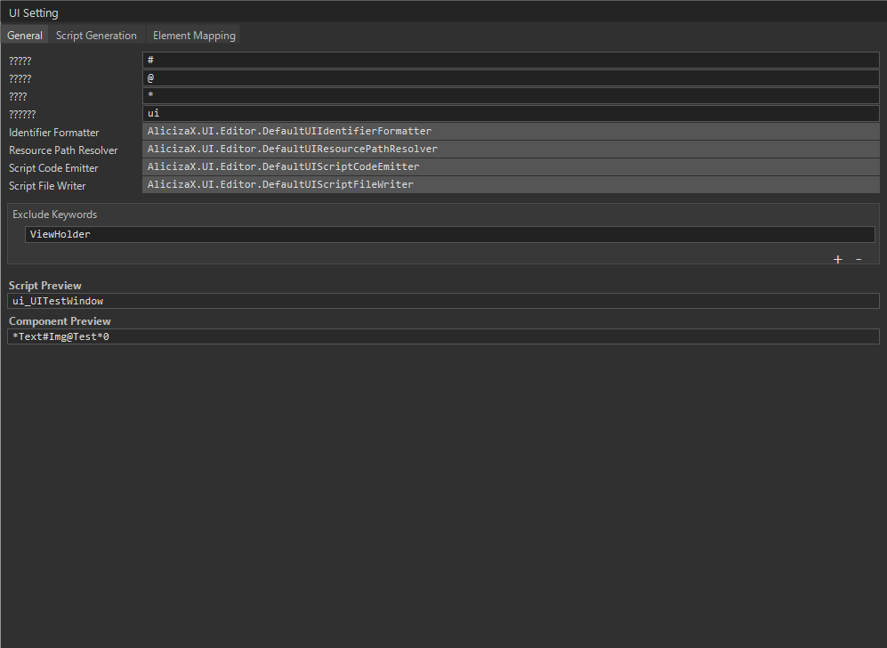
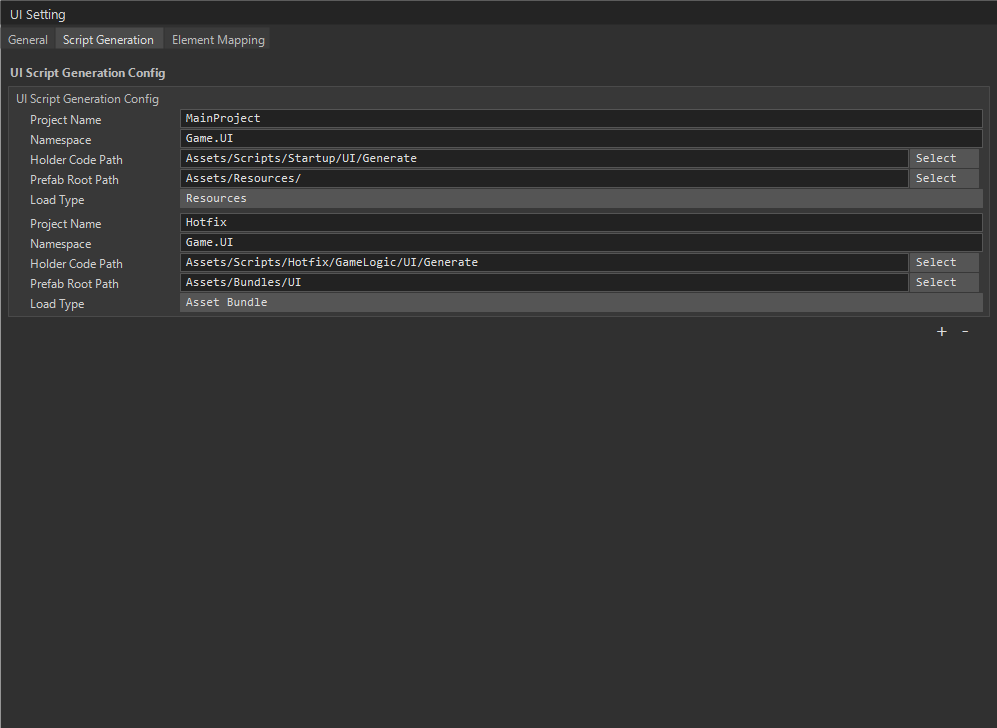
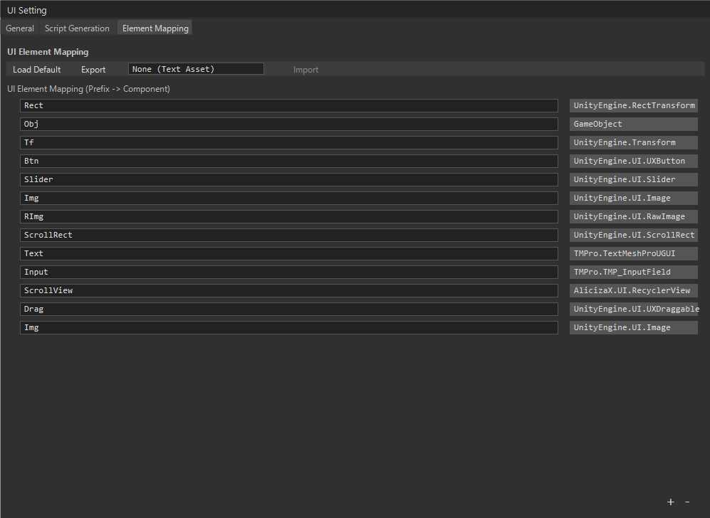
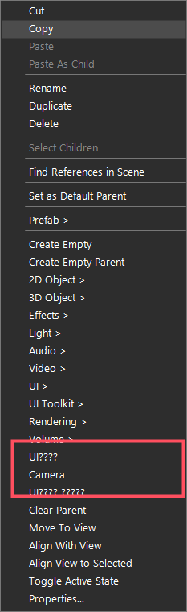

# 元数据与生命周期

窗口逻辑类使用 `WindowAttribute` 描述显示层级和缓存时间：

```csharp
[Window(UILayer.UI, 30)]
public sealed class HomeWindow : UIWindow<ui_HomeWindow>
{
    protected override void OnInitialize()
    {
        baseui.BtnClose.onClick.AddListener(() => CloseSelf().Forget());
    }
}
```

```csharp
public WindowAttribute(UILayer windowLayer, int cacheTime = 0);
```

- `windowLayer`：窗口层级，不能是 `UILayer.All`。
- `cacheTime`：`-1` 永久缓存，`0` 不缓存，`>= 1` 按秒缓存（关场动画结束后开始计时）。

需要每帧更新时添加 `[UIUpdate]`：

```csharp
[UIUpdate]
[Window(UILayer.UI)]
public sealed class BattleHudWindow : UIWindow<ui_BattleHudWindow>
{
    protected override void OnUpdate(float deltaTime) => RefreshHpBar(deltaTime);
}
```

- 只有带 `[UIUpdate]` 的窗口/Widget 才会收到 `OnUpdate`，每帧成本只与这些视图的数量有关。视图必须 `Effective`，自身和所在窗口都必须处于 `Opened`。
- 父节点先于子节点更新；同级 Widget 按进入更新链表的顺序更新，不是创建顺序。不要依赖同级之间的顺序。
- 本帧新进入更新或转场链表的视图从下一帧开始执行；本帧移除的视图不再执行。
- `deltaTime` 来自 `AppServiceRoot.Update`（`Time.deltaTime`）。

Holder 的资源位置使用 `[UIRes]`（写在 Holder 类上，不写在窗口逻辑类上）：

```csharp
[UIRes(ui_LoginWindow.ResTag, EUIResLoadType.AssetBundle)]
public class ui_LoginWindow : UIHolderObjectBase { ... }
```

注册入口：

- 启动期集中注册：`UIMetaRegistry.Register(uiType, holderType, layer, cacheTime, needUpdate, create)` 与 `UIResRegistry.Register(holderType, location, loadType)`。`create` 可省略，省略时用反射创建实例。
- 生成器（`Plugins/SourceGenerators/UI`）在每个程序集生成 `UIGeneratedRegistry.RegisterAll()`，包含 Holder 资源、窗口元数据和实例工厂。生成器修改后要运行 `Build.ps1` 更新 DLL。
- `RegisterAll` 默认由 `RuntimeInitializeOnLoadMethod` 调用。特殊小游戏平台不会调用它时，未注册类型走反射兜底（首次打开打 `UI not pre-registered` Warning）；需要关注性能时，在所属程序集入口手动调用 `AlicizaX.UI.Runtime.UIGeneratedRegistry.RegisterAll()`。
- 生成器诊断：`UI004`（缺少可访问的无参构造函数）、`UI005`（`[Window]` 使用 `UILayer.All`）是编译错误；`UI003`（生成代码无法访问的类型）是 Warning，该类型走反射。

## UISetting 与生成流程

生成器的配置入口是编辑器窗口 `AlicizaX / UISetting Window`，三个页签分别管命名、输出和元素映射。



*General：命名前缀、`Identifier Formatter`、`Resource Path Resolver`、`Script Code Emitter / Writer`、`Exclude Keywords`，下方实时预览生成的脚本与组件。*



*Script Generation：按工程分别配置 `Namespace`、Holder 代码输出目录、Prefab 根目录和加载类型（`Resources` / `Asset Bundle`）。*



*Element Mapping：节点名前缀到组件类型的映射，例如 `Btn` → `UXButton`、`Img` → `Image`、`ScrollView` → `RecyclerView`、`Drag` → `UXDraggable`。*

在 Hierarchy 里选中节点右键即可生成：

{ width="240" }

*右键菜单里的 `UI生成 / 绑定` 与 `UI生成 / 仅复制属性` 两个入口。*

## 生命周期

初始化生命周期内联在 `UIBase` 中，通过虚方法重写：

```csharp
protected virtual void OnInitialize();
protected virtual void OnOpen();
protected virtual void OnRefresh();
protected virtual void OnClose();
protected virtual void OnDestroy();
protected virtual void OnUpdate(float deltaTime);
protected virtual void OnRegisterEvent(EventListenerProxy proxy);
```

语义：

- `OnInitialize`：资源绑定后、首次打开前执行一次；缓存复用不会再次执行。
- `OnOpen`：逻辑打开。钩子执行期间 `IsOpen == false`，返回后才变为 true；开场动画尚未开始。
- `OnRefresh`：已 `Opened` 后再次 `Show` 传参时调用，调用前参数已更新。
- `OnClose`：逻辑关闭（`IsOpen` 已为 false），关场动画尚未完成。
- `OnDestroy`：实例销毁前调用一次。
- `OnUpdate`：仅 `[UIUpdate]` + `Opened` + `Effective` 时每帧调用。
- 业务钩子抛异常会被捕获并记录，生命周期继续推进。

## Holder 生命周期事件

Holder 暴露 6 个事件：

```csharp
OnWindowInitEvent / OnWindowBeforeShowEvent / OnWindowAfterShowEvent
OnWindowBeforeClosedEvent / OnWindowAfterClosedEvent / OnWindowDestroyEvent
```

- 顺序与调用点固定；单个订阅者抛异常只记录日志，不影响其余订阅者。
- 增删订阅时复制回调数组，invoke 路径 0 B。回调内增删订阅从下一次触发开始生效。
- 输入系统等外部模块通过它感知窗口显示/隐藏；不要在回调里做重活。

## 手动创建 Holder

少数场景可手动创建 Holder，例如临时 Tips 多实例，生命周期需要业务自行维护：

```csharp
ui_UILogicTestAlert holder = await UIHolderFactory.CreateUIHolderAsync<ui_UILogicTestAlert>(parent);
ui_UILogicTestAlert sync = UIHolderFactory.CreateUIHolderSync<ui_UILogicTestAlert>(parent);
```

- 资源加载失败或预制体缺 Holder 时返回 `null`，已实例化的对象会被销毁。
- 手动 Holder 没有窗口 owner，不会自动解绑事件或驱动转场。
