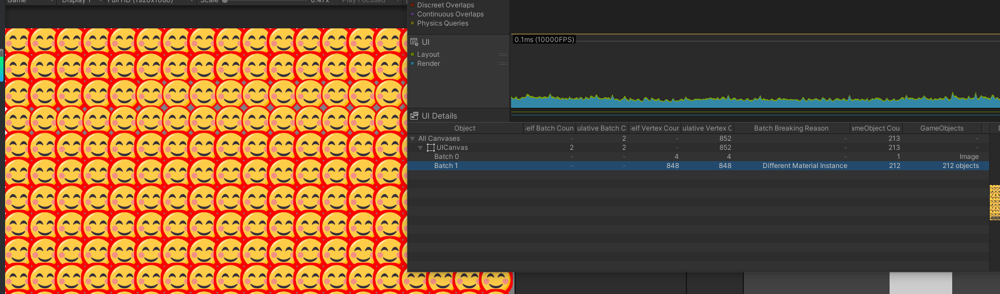

# 分配预算

以下数据只来自 Unity 2022.3.62f3 编辑器（EditMode 和 PlayMode，测试 `UIAllocationCases`、`UIPerformanceTests`、`UIHotPathTests`），不代表 IL2CPP、HybridCLR 和小游戏平台。

常规热路径：

| 路径 | 实测 | 用例 |
| --- | --- | --- |
| 稳态 `Tick`（1、16、512 个更新视图） | **0 B** | `tick-steady-*` |
| 活动 tick 转场（1、16、64 个） | **0 B** | `tick-transitions-*` |
| 缓存窗口关闭、重开，首次和稳态 | **0 B** | `cached-*-first`、`cached-cycle-*` |
| 带缓存时长的窗口开关，稳态 | **0 B**（首次关闭见下表） | `timed-cache-cycle` |
| tick 转场开关，首次和稳态 | **0 B** | `transition-cycle-*` |
| 同步完成的 `ShowUI<T>`（已打开、已缓存），新 `T` 首次调用和稳态 | **0 B**（进程内首次见下表） | `async-show-*` |
| 关闭时有 1–2 个等待者 | **0 B** | `close-two-waiters` |
| Widget 无参 `Open`、`Close`，有无 tick 转场 | **0 B** | `widget-toggle-*` |
| 已加载 Tab 切换 | **0 B** | `tab-switch-loaded` |
| 方法组注册后的事件暂停和恢复 | **0 B** | `event-resume-method-group` |
| 复用代理容量、业务缓存委托时的 `AddUIEvent` | **0 B** | `event-add-cached-delegate` |
| Holder 事件触发、只读查询 | **0 B** | `holder-event-invoke`、`query-paths` |
| 全部 `UITransitionPreset` 的 `Advance` | **0 B** | `preset-advance-*` |

低频路径：

| 路径 | 实测或对象 | 触发条件 | 释放责任 |
| --- | --- | --- | --- |
| 进程内首次 `ShowUI` | 最多 244 B，4 次分配；PlayMode 实测 0 B，随首次调用的时机变化 | 进程内一次，UniTask 和泛型静态初始化 | 进程持有 |
| 创建 Widget（不含 Prefab 实例化成本的差异） | 约 1.5 KB，12–13 次分配，含测试夹具创建 GameObject | 每实例一次 | 随视图回收 |
| 首次异步加载 | 约 1.0–4.8 KB，16–54 次分配；高值出现在它先于其他异步路径运行时 | 每次实际加载 | 加载结束释放；runner 由 UniTask 池持有 |
| 带缓存时长的窗口首次关闭 | 646 B，8 次分配，来源未逐个确认；`AddTimer` 路径没有实例级 `new` | 实测首次；之后 0 B | 未确认 |
| 视图首次有等待者 | 64 B，1 次分配（2 项等待数组） | 每个视图首次 `await` 转场 | 随视图回收 |
| 事件代理首次注册 | 160 B 的订阅数组（4 项，不够时翻倍）；每种事件类型另有一个静态委托；业务写方法组时再加委托 | 代理首次注册；每种事件类型一次 | 数组随代理留在对象池；静态委托进程持有 |
| 带一个值类型参数打开 | 60 B，2 次分配（数组和装箱） | 用户操作级别 | 关闭或替换时释放 |
| 导航 | `NavigationCommand`、UCS、CTS、`UIRouteEntry`，有参数时再加数组 | 每次导航 | 命令结束释放，条目随 history |
| 异步转场源 | CTS 和 UniTask runner | 非 tick 转场每次播放 | 播放结束释放 |
| 未完成任务上调用 `Forget()` | UniTask 池化的 `StateTuple` | 业务调用 `CloseSelf().Forget()` 且有转场 | UniTask 池 |
| Tab 排队切换 | `TabRequest`、UCS | 目标未加载，或上一 Tab 还在关闭 | 请求结束释放 |
| 钩子内重入打开 | 一个 `UniTaskCompletionSource<bool>` | 在钩子内调用 `ShowUI` | 逻辑打开完成释放 |
| 同一转场超过 2 个等待者 | 一次数组扩容 | 第 3 个等待者 | 随视图回收 |
| 反射注册兜底 | 特性读取、注册表项和创建委托，打 Warning | 未注册类型首次使用 | 注册表持有到进程结束 |

每帧或每次高频调用不应出现新的托管分配；任何无法消除的分配都必须在上表中登记触发条件、数量、频率与释放责任。

Holder 所在 GameObject 被外部销毁时，所属视图立即按 `DestroyNow` 释放。例外：从未激活过的 Holder 不会收到 `OnDestroy`，视图收不到通知，之后访问会抛 `MissingReferenceException`。Prefab 根节点应保持激活。

隐藏只切显示状态：窗口切 layer 和 `Canvas.enabled`，Widget 切 `CanvasGroup`。隐藏和缓存期间，节点上的 MonoBehaviour 继续运行，也不会触发 `OnEnable`、`OnDisable`，进出缓存也不触发 `OnTransformParentChanged`。带 `Update`、粒子或 Animator 的组件，要在 `OnClose` 和 `OnOpen` 里自行停止和恢复。

## 用 Profiler 看批次

*Profiler 的 UI 详情面板：Batch 1 的打断原因是 `Different Material Instance`，212 个 GameObject 被拆成两批。同层 UI 混用多套材质或图集时会额外增加批次，合并图集、复用材质能直接减少 draw call。*
