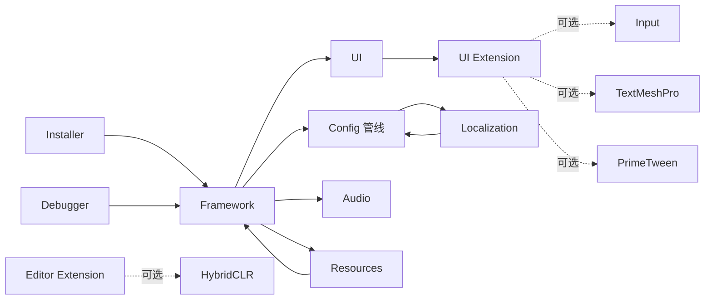

# 概览

AlicizaX 把常用能力拆成 17 个一级模块：服务容器承住全局依赖，资源与对象池扛住加载和复用，UI、音频、本地化分别负责界面、声音和文案，配置管线负责把 Excel 变成代码与数据。每个模块都可以单独接入，也可以按 [快速开始](quickstart.md) 的路径一次性跑通。

## 模块一览

| 模块 | 核心能力 | 入口 |
| :--- | :--- | :--- |
| **Service** 服务容器 | 契约注册与解析、Tick 生命周期、Mono 服务、关闭顺序 | [Service](modules/service/index.md) |
| **Timer** 计时器 | 一次性/重复计时、暂停恢复、与时间缩放解耦 | [Timer](modules/timer/index.md) |
| **Event** 事件 | 事件总线、通道与容器、订阅生命周期、事件监视窗口 | [Event](modules/event/index.md) |
| **Procedure** 流程 | 启动状态机、流程切换、资源包与热更加载链路 | [Procedure](modules/procedure/index.md) |
| **Resources** 资源 | 基于 YooAsset、资源租赁、作用域、资源包与下载 | [Resources](modules/resource/index.md) |
| **Scene** 场景 | 主场景/附加场景加载、挂起与激活、卸载 | [Scene](modules/scene/index.md) |
| **GameObjectPool** 实例池 | 池配置、策略、句柄回收、预热与清理 | [GameObjectPool](modules/gameobjectpool/index.md) |
| **MemoryPool** 内存池 | `MemoryObject` 租还、预算与峰值统计 | [MemoryPool](modules/memorypool/index.md) |
| **UI** 界面 | 窗口声明与生命周期、路由转场、Widget/Tab、缓存 | [UI](modules/ui/index.md) |
| **Audio** 音频 | 2D/3D 播放、分组音量、跟随目标、Clip 缓存 | [Audio](modules/audio/index.md) |
| **Input** 输入 | 设备监听、读取、重绑定、快捷键、导航、图标、反馈 | [Input](modules/input/index.md) |
| **UI Extension** 扩展组件 | `UXSelectable`/`UXButton`/`UXToggle`/`UXGroup`/`UXImage`/`UXDraggable` | [UI Extension](modules/ui-extension/index.md) |
| **RecyclerView** 虚拟列表（UI Extension 子模块） | 普通/多模板/循环/分组列表、ViewHolder 复用、列表导航 | [RecyclerView](modules/ui-extension/recyclerview/index.md) |
| **Localization** 本地化 | `LocalizationSettings` 词库、运行时切换、TMP 绑定与预览 | [Localization](modules/localization/index.md) |
| **Config** 配置管线 | Excel + Luban 生成代码与 `.bytes`，支持多语言列 | [Config](modules/config/index.md) |
| **Debugger** 调试器 | 窗口树、日志面板、命令控制台、系统/Profiler 信息 | [Debugger](modules/debugger/index.md) |
| **Editor Extension** 编辑器扩展 | 图集工具、Texture Packer、引用查找、HybridCLR 构建 | [Editor Extension](modules/editor-extension/index.md) |
| **Installer** 安装器 | 安装核心包、导入 Normal/Hybrid 模板、安装状态修复 | [Installer](modules/installer/index.md) |

## 依赖关系

- **必装**：`com.alicizax.unity.framework`。
- **可选**：ui.extension、input、debugger、localization、editor.extension。
- `input` 依赖 Unity Input System；`ui.extension` 的列表导航依赖 `input`。
- 配置表由仓库根目录 `Config/` 生成，不属于 UPM 包。

## 三步上手

1. **跑通启动链路**：打开 [快速开始](quickstart.md)，从 `Entry.prefab`、`ProcedureEntry` 到第一个界面走一遍。

2. **按需求挑模块**：每篇文档按「适用场景 → 使用前提 → 最短接入 → 核心用法 → 常见配置 → 容易踩的坑」组织，先确认前提，再抄示例。

3. **接入自己的流程**：注册自定义服务、生成配置表、打开业务 UI、申请资源租约；需要热更时再按 HybridCLR 流程接。

