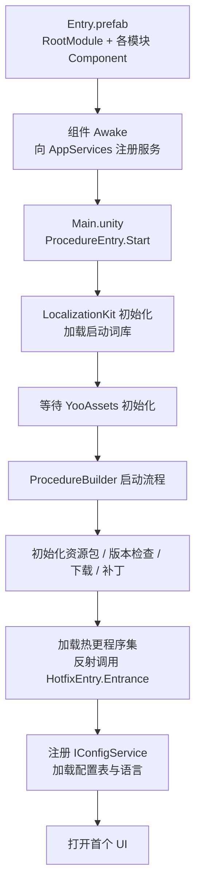

# 快速开始

从安装框架、铺设项目模板到跑通第一个界面，这一页按顺序走完。各模块的细节见左侧对应文档。

## 1. 安装

1. **添加安装器**：Package Manager → `+` → Add package from git URL：

    ```text
    https://github.com/AlicizaX/FramworkInstaller.git
    ```

2. **打开安装器**：菜单 `AlicizaX / Installer`。窗口会自动补齐 OpenUPM 作用域（`com.cysharp`、`com.alicizax.unity`、`com.tuyoogame`）并等待 Package Manager 解析。

3. **安装核心库**：点 `Install Core`，安装 `com.alicizax.unity.framework`。装好后模板入口才解锁。

4. **选择模板**：
   - `Normal Template`：标准项目结构。
   - `Hybrid Template`：额外包含热更工程与 `ENABLE_HYBRIDCLR`。

5. **Install Template**：模板会被复制到当前项目的 `Assets/`，同时设置 `allowUnsafeCode` 与脚本符号。

安装器细节与失败处理见 [Installer 安装器](modules/installer/index.md)。

## 2. 可选扩展包

| 包 | 用途 | 建议 |
| :--- | :--- | :--- |
| `com.alicizax.unity.framework` | 服务容器、资源、UI、事件、计时、对象池 | **必装**（安装器已装） |
| [`com.alicizax.unity.ui.extension`](modules/ui-extension/index.md) | `UXButton`、`UXImage`、`UXToggle`、`RecyclerView` 等 | 有 UI 就装 |
| [`com.alicizax.unity.editor.extension`](modules/editor-extension/index.md) | 图集工具、Texture Packer、引用查找、HybridCLR 构建 | 推荐 |
| [`com.alicizax.unity.input`](modules/input/index.md) | 设备监听、重绑定、快捷键、UI 导航、输入图标、反馈 | 需要手柄/键盘导航时 |
| [`com.alicizax.unity.debugger`](modules/debugger/index.md) | 运行时日志、命令控制台、系统信息、Profiler | 开发期推荐 |
| [`com.alicizax.unity.localization`](modules/localization/index.md) | 多语言词库、TMP 绑定与编辑器预览 | 多语言项目 |
| [`com.alicizax.unity.installer`](modules/installer/index.md) | 安装器本身 | 安装期需要 |

依赖注意：

- `com.alicizax.unity.input` 依赖 Unity **Input System**，未安装时输入模块不可用。
- `com.alicizax.unity.ui.extension` 的列表导航依赖 `com.alicizax.unity.input`，通过 `UXNAVIGATION_SUPPORT` 宏条件编译。
- 配置表由仓库根目录的 `Config/` 管线生成，不是 UPM 包，见 [Config 配置管线](modules/config/index.md)。

## 3. 启动链路

模板跑起来后的真实顺序：



### 3.1 框架根节点

`Entry.prefab` 在 `Client/Packages/com.alicizax.unity.framework/Runtime/Prefabs/`，结构是：

```text
Entry (RootModule)
├─ UI            (UIComponent)
├─ Memory Pool   (MemoryPoolSetting)
├─ Resources     (ResourceComponent)
├─ Audio         (AudioComponent)
├─ GameObjectPool(GameObjectPoolComponent)
├─ Scene         (SceneComponent)
└─ Timer         (TimerComponent)
```

- `RootModule`（`DefaultExecutionOrder(-32000)`）最先创建服务容器、设置帧率/时间缩放/后台运行，并在退出时按顺序销毁服务。
- 各子节点在自己的 `Awake` 里注册服务，顺序由 `DefaultExecutionOrder` 决定：`MemoryPoolSetting(-1000)` → `TimerComponent(-800)` → `ResourceComponent(-700)` → `SceneComponent(-600)` → `UIComponent(-500)` → `AudioComponent(-400)` → `GameObjectPoolComponent(默认)`。
- 服务解析统一走 `AppServices` 或 `GameApp` 快捷入口。

详见 [Service 服务容器](modules/service/index.md)。

### 3.2 启动流程

`Main.unity` 上的 `ProcedureEntry` 负责点火：

```csharp
private async UniTaskVoid Start()
{
    LocalizationKit.Initialize(Resources.Load<LocalizationSettings>("Localization/Settings"));
    if (!await LocalizationKit.AddTableAsync(
            "StartupTable", new ResourcesTableSource("Localization/StartupTable_{locale}")))
        throw new InvalidOperationException("Startup localization could not be loaded.");

    await UniTask.WaitUntil(() => YooAsset.YooAssets.IsInitialized);
    ProcedureBuilder.InitializeProcedure(
        new List<ProcedureBase>
        {
            new ProcedureEntryState(),
            new ProcedureGetAppVersionInfoState(),
            new ProcedureInitPackageState(),
            new ProcedureDownloadBundleState(),
            new ProcedurePatchDoneState(),
            new ProcedureLoadAssembly(),
            new ProcedureUpdateFinishState(),
        },
        typeof(ProcedureEntryState));
    Destroy(gameObject);
}
```

流程依次完成：判断播放模式与网络、初始化资源包、检查版本、下载/更新、清理缓存、加载热更程序集。详见 [Procedure 流程](modules/procedure/index.md)。

### 3.3 热更入口

`ProcedureLoadAssembly` 加载 `GameLib` / `GameProto` / `GameBase` / `GameLogic` 后，反射调用：

```csharp
// Assets/Scripts/Startup/StartupSetting.cs
public const string EntranceDll = "GameLogic.dll";
public const string EntranceClass = "GameLogic.HotfixEntry";
public const string EntranceMethod = "Entrance";
```

`HotfixEntry.EntranceAsync` 里完成配置表与本地化的装配：

```csharp
if (!await LocalizationKit.AddTableAsync(
        "CommonTable", new AssetBundleTableSource("CommonTable_{locale}")))
    throw new InvalidOperationException("Common localization could not be loaded.");

ConfigService = AppServices.Register<IConfigService>(new ConfigService());
await ConfigService.Initialize(new ConfigBytesLoader());
await ConfigService.SetLanguageAsync(LocalizationKit.CurrentLanguage);
ConfigService.SetLanguageBinding(
    LocalizationKit.RegisterLanguageLoader(ConfigService.SetLanguageAsync));

await GameApp.UI.ShowUI<UIHomeWindow>();
```

配置表的生成与装配见 [生成物与运行时衔接](modules/config/outputs.md)。

## 4. 三步上手

1. **先确认启动链路**：打开 `Assets/Scenes/Main.unity` 进播放模式，确认 Console 没有服务注册失败、资源包初始化失败。
2. **接第一个窗口**：按 [UI 界面](modules/ui/index.md) 声明窗口与 Holder，用 `GameApp.UI.ShowUI<T>()` 打开。
3. **按需求挑模块**：资源、音频、本地化、输入、调试器都是独立包，用到再装；每个模块页面都是“使用前提 → 最短接入 → 核心用法 → 坑”的结构。

## 5. 常见问题

| 现象 | 先查 |
| :--- | :--- |
| `Service ... is not registered` | 对应模块的 Component 是否挂在框架根节点上，是否在 `Awake` 中注册成功（[Service](modules/service/index.md)） |
| 资源加载失败 | 资源是否在 YooAsset 收集目录、地址是否为去扩展名的文件名（[Resources](modules/resource/index.md)） |
| 配置表读不到 | 是否执行过 `gen-all`、`Configs/bytes` 是否打进包（[Config](modules/config/index.md)） |
| 画面没有文案 | `LocalizationKit` 是否初始化、语言包是否加载（[Localization](modules/localization/index.md)） |
| 热更没生效 | 先确认 `ENABLE_HYBRIDCLR` 与 DLL 是否打进包（[Procedure](modules/procedure/index.md)） |
